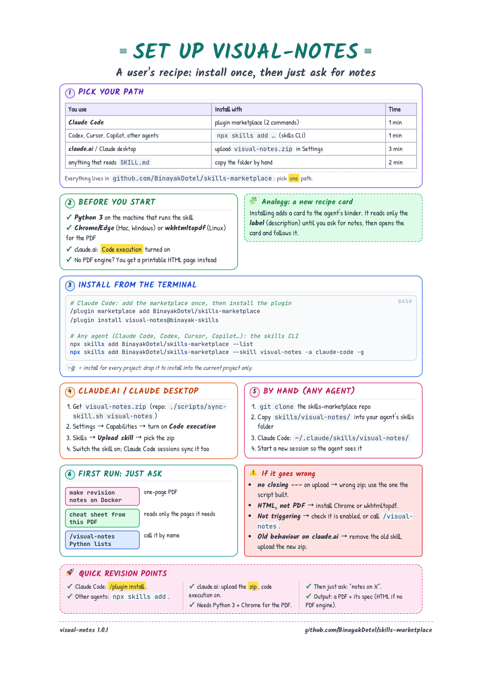

# skills-marketplace

Reusable skills for AI agents. Each skill is a folder with a `SKILL.md` that follows the open [Agent Skills](https://agentskills.io/specification) format, so it works in Claude (Code, desktop, claude.ai) and in other agents that read the same format, such as Codex, Cursor and GitHub Copilot.

## See it

<a href="docs/showcase/visual-notes-setup/visual-notes-setup.pdf"></a>

This setup guide was made by `visual-notes` itself. The agent wrote the content as a [JSON spec](docs/showcase/visual-notes-setup/visual-notes-setup.spec.json), and the skill's renderer turned it into [this A4 PDF](docs/showcase/visual-notes-setup/visual-notes-setup.pdf). The agent never writes HTML, so every page has the same look.

The same spec gives the same page every time. To check, render it yourself:

```bash
python3 skills/visual-notes/scripts/render_note.py \
  docs/showcase/visual-notes-setup/visual-notes-setup.spec.json /tmp/setup.html --pdf-only
```

`docs/` is not part of any skill, so installs stay small.

<br clear="right">

## Skills

| Skill | What it does | Version |
|---|---|---|
| [visual-notes](skills/visual-notes/) | Turns a topic, document or rough notes into a hand-drawn-style one-page study sheet (cheat sheet / revision notes) as a printable A4 PDF. | 1.0.2 |
| [conventional-commits](skills/conventional-commits/) | Writes clear Conventional Commits messages (typed subject, body, breaking-change and issue footers) from a diff, staged changes or a short description of the work. | 1.0.0 |
| [research](skills/research/) | Researches a topic on the web and returns a sourced fact brief: each claim with a link and an exact quote, legend kept apart from history, disputes and myths flagged, plus a JSON block apps can import. | 1.0.0 |
| [setup-project](skills/setup-project/) | One-time repo setup for dev-flow: project profile (`AGENTS.md`), justfile command contract, stack rules from packs, GitHub issue tracking, design contract. Never edits skills. | 1.0.0 |
| [tickets](skills/tickets/) | Turns one spec section into small, ordered GitHub issues with acceptance criteria, Files, dependencies and a milestone. | 1.0.0 |
| [take](skills/take/) | Takes the next ticket, grills its open decisions (max 8), writes Decisions and Files. No code. | 1.0.0 |
| [implement](skills/implement/) | Builds the ticket test-first, runs checks and a two-axis review, opens the PR, moves the ticket to review. | 1.0.0 |
| [address](skills/address/) | Fixes PR review comments on the same branch and updates the PR. | 1.0.0 |
| [done](skills/done/) | After merge: marks merged tickets done and names the next one. | 1.0.0 |
| [design-package](skills/design-package/) | Designs an app's look once as files a weaker model can follow: Tailwind tokens, reference screens in the app's own classes, components gallery, contract. Run with a strong model. | 1.0.0 |
| [ui-from-reference](skills/ui-from-reference/) | Builds web UI by translating approved reference screens and tokens, then compares screenshots side by side. | 1.0.0 |

## Dev flow

Eight skills that run a ticket lifecycle in any repo without being edited per project. Skills are global; each repo only holds its own facts.

```
/setup-project            once per repo: AGENTS.md, justfile contract, stack rules, GitHub tracking
/tickets <spec section>   plan a phase into small issues on the board
/take → /implement → /address → /done   one chat per step
```

For web UI, run `/design-package` once with a strong model (Claude); after that, cheaper models build each screen with `ui-from-reference` and check it with `just shots`.

They rely on Matt Pocock's skills (`grilling`, `tdd`, `code-review`, `pr`) from [mattpocock/skills](https://github.com/mattpocock/skills), installed alongside and never edited. `setup-project` carries stack packs (Next.js, Convex, Vitest, web UI, LLM code, pnpm monorepo, Godot starter) under `skills/setup-project/packs/`.

**Make them global for Cursor and Claude Code:** `./scripts/sync-skill.sh --all` symlinks every skill into `~/.claude/skills`, which Cursor also reads, so edits here apply to every project at once.

## Install

**Claude Code** (plugin marketplace):

```
/plugin marketplace add BinayakDotel/skills-marketplace
/plugin install visual-notes@binayak-skills
```

**Any supported agent** ([skills CLI](https://github.com/vercel-labs/skills): Claude Code, Codex, Cursor, Copilot and more):

```bash
npx skills add BinayakDotel/skills-marketplace --list                   # see what's here
npx skills add BinayakDotel/skills-marketplace --skill visual-notes     # pick an agent when asked
npx skills add BinayakDotel/skills-marketplace --skill visual-notes -a claude-code -g   # global, no prompt
```

**claude.ai / Claude desktop**: build `dist/visual-notes.zip` with `./scripts/sync-skill.sh visual-notes`, then Settings → Capabilities → Skills → Upload skill. Code execution must be on.

**By hand**: copy `skills/<name>/` into your agent's skills folder (for Claude Code, `~/.claude/skills/<name>/`).

**Chat apps without skill support** (ChatGPT, Grok and others): paste the skill's `SKILL.md` as project instructions or as the first message, then send your request. Pure-instruction skills such as `research` and `conventional-commits` work this way; `research` also needs the app's web search turned on.

Some skills run bundled scripts, so the agent needs a shell. `visual-notes` needs Python 3, plus headless Chrome/Edge or wkhtmltopdf for the PDF. Without them it delivers the HTML page instead.

## Layout

```
.claude-plugin/marketplace.json   catalog: one plugin per skill (marketplace name: binayak-skills)
skills/<name>/                    SKILL.md, scripts/, references/, assets/, examples/, CHANGELOG.md
scripts/validate.py               checks every skill against the spec and the catalog (also run in CI)
scripts/sync-skill.sh             validate -> link into ~/.claude/skills -> build dist/<name>.zip
```

## Working on a skill

```bash
./scripts/sync-skill.sh visual-notes    # once: symlinks ~/.claude/skills/visual-notes to this repo, so edits apply instantly
# edit skills/visual-notes/...
./scripts/sync-skill.sh visual-notes    # re-validate and rebuild the zip; says when claude.ai needs a re-upload
```

To add a skill:

1. Create `skills/<name>/SKILL.md`. The frontmatter `name` must equal the folder name: lowercase letters, digits and single hyphens.
2. Add a plugin entry to `.claude-plugin/marketplace.json` with `"source": "./skills/<name>"`.
3. Add a row to the table above and a `CHANGELOG.md` in the skill folder.
4. Run `python3 scripts/validate.py`.

When you change a skill, bump its `version` in `marketplace.json` so Claude Code users get the update.

## Credits

The look of `visual-notes` is inspired by the hand-drawn revision notes of the Developer Blz notebook series and similar Python revision-notes pages. No branding from them is used.

## License

[MIT](LICENSE). Bundled fonts in `skills/visual-notes/assets/fonts/` are under the SIL Open Font License ([LICENSE-OFL.txt](skills/visual-notes/assets/fonts/LICENSE-OFL.txt)).
